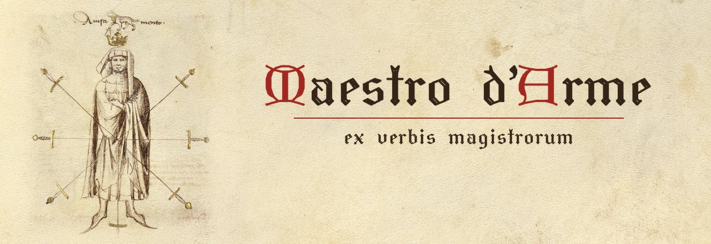

<h1 align="center">
  
</h1>

<p align="center"><i>English · <a href="README.it.md">Italiano</a></i></p>

**Maestro d'Arme** ("master of arms") is an assistant for asking natural-language
questions about **historical European fencing treatises** (HEMA), across masters and
traditions, with answers grounded in the original texts and citations down to the
manuscript folio.

> *"How do you parry a downward blow according to Fiore dei Liberi?"* → the exact
> passage of the treatise, in 15th-century Italian, with a translation and the
> folio reference (e.g. *Fior di Battaglia, MS Ludwig XV 13, f. 23r*).
>
> *"How does Fiore's posta di donna compare with Liechtenauer's vom Tag?"* → the
> relevant passages of both masters side by side, each with its own citation,
> without blending the two traditions into one.

The treatises are added one at a time: *Fior di Battaglia* by Fiore dei Liberi
(Italian tradition, c. 1410) is the first; Liechtenauer's Zettel with its glosses and
Joachim Meyer's *Gründtliche Beschreibung* (German tradition) come next.

**Status**: work in progress. The text acquisition module is ready, and the parser
for the first treatise is being built; the rest of the pipeline is described in the
[roadmap](#roadmap).

---

## The problem

Historical fencing treatises are a hard domain, for people and for general-purpose
language models alike:

- **archaic, specialised language**: 15th-century Italian, Early New High German,
  Latin, with spellings that vary even within the same text;
- **many independent works**: each master has his own vocabulary and his own system
  of guards;
- **contested interpretation**: there is the original text, and there are modern
  interpretations, and the two must be kept apart.

A general-purpose LLM gives plausible answers without verifiable sources, and tends
to blend different traditions together. This project aims for the opposite: **the
original text is the source of truth**, and every answer must be traceable to a
specific passage.

## Planned architecture

The system is designed in two layers:

1. **Library (RAG over the treatises)**: the texts are split into passages, indexed
   with hybrid search (multilingual semantic search + BM25 lexical search) and
   returned together with their citation. This is the source of truth.
2. **Synthesis wiki**: valuable syntheses (for example, a comparison between two
   guards) are saved as Markdown pages that cite the original passages, with
   periodic checks that those citations are still valid.

Everything runs locally, with open-source models.

## What works today: text acquisition

The texts come from [Wiktenauer](https://wiktenauer.com), the main digital library
of HEMA treatises. The `maestro.acquire.wiktenauer` module:

- uses the **MediaWiki API** (`action=parse`) instead of scraping the pages: it
  returns only the content, without menus and scripts;
- records the **revision** of each downloaded page, so it is always possible to know
  which version of the text was used;
- sends **at most one request per second**, with a User-Agent that identifies the
  project: the site is run by volunteers;
- **retries** up to 3 times on network or server errors, with increasing waits; it
  does not retry API errors (e.g. a page that does not exist), because retrying
  would not change the result.

## Installation

Requirements: Python 3.11 or later.

```bash
git clone https://github.com/MariPS/maestro-darme.git
cd maestro-darme
conda create -n maestro-darme python=3.11 -y
conda activate maestro-darme
pip install -e .
```

To work on the code, install the development tools too and run the tests:

```bash
pip install -e ".[dev]"
pytest
```

The tests run on a small HTML file in `tests/fixtures/`: they need neither the
internet nor the downloaded corpus.

## Usage

From the project root:

```bash
python scripts/01_acquire.py
```

The script downloads the page for Fiore dei Liberi (*Fior di Battaglia*, c. 1410)
into `corpus/raw/fiore/`. If the file is already there, it is not downloaded again.

Next to the HTML, a `.meta.json` file records the provenance:

```json
{
  "title": "Fiore de'i Liberi",
  "revid": 163576,
  "url": "https://wiktenauer.com/wiki/Fiore_de'i_Liberi",
  "downloaded_at": "2026-10-21T18:16:22+00:00"
}
```

## Repository layout

```
maestro-darme/
├── pyproject.toml
├── src/maestro/
│   ├── config.py             # paths and settings shared by more than one module
│   ├── acquire/
│   │   └── wiktenauer.py     # client for the Wiktenauer MediaWiki API
│   └── parse/
│       ├── schemas.py        # TreatisePassage: the validated shape of a passage
│       └── fiore.py          # parser for Fiore dei Liberi (in progress)
├── scripts/
│   ├── 01_acquire.py         # downloads the treatises into corpus/raw/
│   └── explore_html.py       # summarises the tables of a downloaded page
├── tests/
│   ├── fixtures/
│   │   └── mini_fiore.html   # a miniature of the real page, with all its traps
│   └── test_parse_fiore.py
├── docs/
│   ├── DEVLOG.md             # findings and design decisions
│   └── images/               # banner, logo and social preview
└── corpus/                   # generated by the scripts, not versioned
```

To see how the downloaded HTML is organised before parsing it:

```bash
python scripts/explore_html.py corpus/raw/fiore/fiore_de_i_liberi.html      # all tables
python scripts/explore_html.py corpus/raw/fiore/fiore_de_i_liberi.html 1    # one table, cell by cell
```

What this exploration revealed (and why it shapes the parser) is described in the
[development log](docs/DEVLOG.md).

## Roadmap

- [x] Text acquisition from Wiktenauer, with provenance and revision tracking
- [ ] Parsing of the transcriptions into structured passages (original text, translation, folio)
- [ ] Indexing with multilingual embeddings
- [ ] Hybrid semantic + BM25 search, with normalisation of historical spelling
- [ ] Evaluation on a set of questions with expected sources (recall@k, MRR)
- [ ] Answers generated by a local LLM, with automatic citation checking
- [ ] Synthesis wiki with maintenance checks
- [ ] Web interface

First treatise: *Fior di Battaglia* by Fiore dei Liberi (Getty manuscript).
Planned next: Joachim Meyer (1570) and Liechtenauer's Zettel with its glosses.

## Text sources and licences

The original treatises are in the public domain. The **transcriptions** and
**translations** belong to [Wiktenauer](https://wiktenauer.com) and their authors,
and are generally distributed under the **CC-BY-SA 4.0** licence.

The corpus is **not included** in this repository: it is downloaded by the script,
and every file keeps the URL and revision of its source.

## Images

The banner, the logo (`docs/images/logo.png`) and the social preview use the
*Segno* of Fiore dei Liberi, *Fior di Battaglia*, Los Angeles, J. Paul Getty Museum,
MS Ludwig XV 13, f. 32r: the master with the seven swords and the four animals of
the virtues (prudence, speed, daring, strength), chosen as an emblem of the master of
arms in general, whatever the tradition. Digital image courtesy of the Getty's Open Content Program, via
[Wiktenauer](https://wiktenauer.com).

The motto under the title, *ex verbis magistrorum*, is Latin for "from the words of
the masters": the principle of the project, where every answer comes from the
masters' own texts.

The title is lettered with the Hershey *Gothic Italian* font. The Hershey Fonts were
originally created by Dr. A. V. Hershey while working at the U. S. National Bureau
of Standards; the format of the font data was originally created by James Hurt,
Cognition, Inc.
